# NYC Taxi Trips — Azure Databricks Data Engineering Pipeline

End-to-end data engineering project for processing NYC Yellow and Green Taxi trip data using Azure Databricks, Apache Spark, Delta Lake, ADLS Gen2, Terraform, and Lakeflow Declarative Pipelines.

A serverless Lakeflow pipeline incrementally ingests trip files, quarantines invalid rows, and publishes route metrics to an AI/BI dashboard. A separate wheel-based job encrypts the synthetic customer pool and writes it to a restricted Unity Catalog table.

---

## Architecture

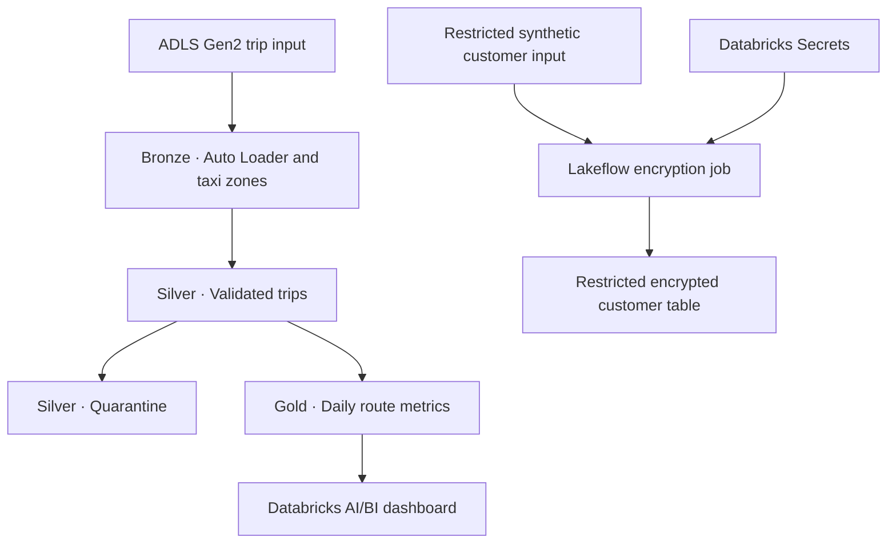

The medallion pipeline runs on serverless compute in triggered mode. Terraform provisions Azure and Unity Catalog storage and access. The Databricks bundle deploys the pipeline, encryption job, dashboard, and analytics schemas.

---

## Technology Stack

| Technology                     | Purpose                                  |
| ------------------------------ | ---------------------------------------- |
| Microsoft Azure                | Cloud platform                           |
| Azure Data Lake Storage Gen2   | Data lake storage                        |
| Azure Databricks               | Data engineering and analytics platform  |
| Apache Spark / PySpark         | Distributed data processing              |
| Spark Structured Streaming     | Incremental processing                   |
| Databricks Auto Loader         | Incremental file ingestion               |
| Delta Lake                     | Storage layer for pipeline tables        |
| Lakeflow Declarative Pipelines | Bronze → Silver → Gold orchestration     |
| Unity Catalog                  | Data and external-storage governance     |
| Databricks bundles             | Pipeline, job, schema, and dashboard deployment |
| Spark SQL and Databricks Secrets | AES-256-GCM encryption and runtime key access |
| Databricks AI/BI               | Dashboarding and analytics               |
| GitHub Actions                 | Python, Spark, Terraform, and bundle schema checks |
| Terraform                      | Infrastructure as Code                   |
| Python                         | Processing utilities and data enrichment |
| SQL                            | Analytics and data exploration           |

---

# Data

The project uses:

* NYC Yellow Taxi trip records
* NYC Green Taxi trip records
* NYC Taxi Zone Lookup data

The trip datasets are stored as Parquet files, while the Taxi Zone Lookup dataset is stored as CSV.

For the incremental-ingestion demonstration, taxi data from **January, February, and March** is used.

The trip inputs land in the Unity Catalog volume `<catalog>.landing.trips`.

```text
/Volumes/<catalog>/landing/trips/
├── yellow/
│   └── *.parquet
├── green/
│   └── *.parquet
└── reference/
    └── taxi_zone_lookup.csv
```

The synthetic customer pool uses a separate restricted volume. The two paths use different run identities.

---

# Medallion Architecture

## Bronze Layer

The Bronze layer incrementally ingests Yellow and Green Taxi Parquet files from ADLS Gen2 using **Databricks Auto Loader**.

It performs:

* incremental file discovery;
* streaming ingestion;
* source-file lineage and rescued-data capture;
* raw Delta-table creation;
* Taxi Zone reference-data ingestion.

Bronze trip tables can retain a synthetic customer ID. The customer job handles names and emails in a separate restricted workflow.

The static taxi-zone lookup is a materialized view over the CSV. It can show `FULL_RECOMPUTE` on a normal update. The Bronze trip flows show whether new trip files were ingested incrementally.

Bronze tables include:

```text
bronze.yellow_trips_raw
bronze.green_trips_raw
bronze.taxi_zones_raw
```

---

## Silver Layer

The Silver layer reads the Bronze taxi tables and applies data-quality rules using **Lakeflow expectations**.

Validation covers conditions such as:

* required pickup and drop-off timestamps;
* drop-off time occurring after pickup time;
* valid pickup and drop-off location IDs;
* valid trip-distance values.

Rejected records are routed to the taxi-specific Silver quarantine tables with reason codes and source lineage. Use the Lakeflow Data quality tab and pipeline event log to inspect expectation results after each update. [Lakeflow expectations](https://learn.microsoft.com/en-us/azure/databricks/ldp/expectations)

Silver tables:

```text
silver.yellow_trips
silver.green_trips
silver.yellow_trips_quarantine
silver.green_trips_quarantine
```

---

## Gold Layer

The Gold layer integrates Yellow and Green Taxi records into a common analytical model.

Both taxi types are normalized and written into the unified trip dataset:

```text
all_taxi_trips
```

The trips are then enriched using Taxi Zone reference data and aggregated into:

```text
daily_route_metrics
```

The route grain is pickup date, taxi type, pickup zone ID, and drop-off zone ID. Zone names are display labels. Gold stores additive totals and counts, and the dashboard computes ratios after applying filters and grouping.

* Average charges, tips, distance, and duration use the count of trips with the corresponding value.
* Card share uses all trips. The recorded card tip rate uses card trips with both a fare and a tip amount.
* Charges per mile uses trips with both a passenger charge and a distance.

## Dev table layout and refresh checks

Start fresh dev Bronze and Silver tables without physical day partitions. The pickup date fields remain available for filtering and Gold aggregation. Use a fresh dev deployment for this baseline so it has clean tables and checkpoint state.

After the initial load and the incremental update, capture `numFiles`, `sizeInBytes`, and `partitionColumns` from `DESCRIBE DETAIL` for the Bronze and Silver trip tables. Compare bytes per file and the same date-filtered query's scan size and runtime across runs. Consider clustering only when the observed file layout or query profile justifies it. [Delta partitioning](https://learn.microsoft.com/en-us/azure/databricks/tables/partitions)

For the Gold materialized view, use its deployed three-part name and inspect the `planning_information` events. Record the reported refresh technique for the incremental run. [Materialized-view refresh techniques](https://learn.microsoft.com/en-us/azure/databricks/ldp/incremental-refresh/#determine-the-refresh-type-of-an-update)

```sql
SELECT timestamp, origin.update_id AS update_id, message
FROM event_log(TABLE(<catalog>.<schema>.daily_route_metrics))
WHERE event_type = 'planning_information'
ORDER BY timestamp DESC;
```

---

# Incremental Processing

The project demonstrates incremental ingestion using two pipeline executions.

## Initial Load — January

Initially, only January Yellow and Green Taxi files are placed in the ADLS landing directories.

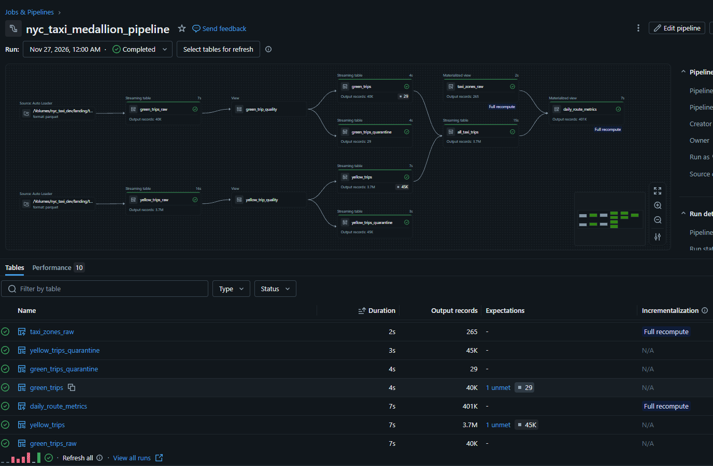

The first pipeline execution processes January data through:

```text
ADLS
  ↓
Bronze
  ↓
Silver
  ↓
Gold
```

---

## Incremental Load — February and March

February and March files are subsequently added to the same landing directories.

On the next pipeline execution, Auto Loader detects the newly arrived files and processes the additional data.

Previously discovered source files do not need to be ingested again. The update adds four Parquet files, one per taxi type for each of the two months.

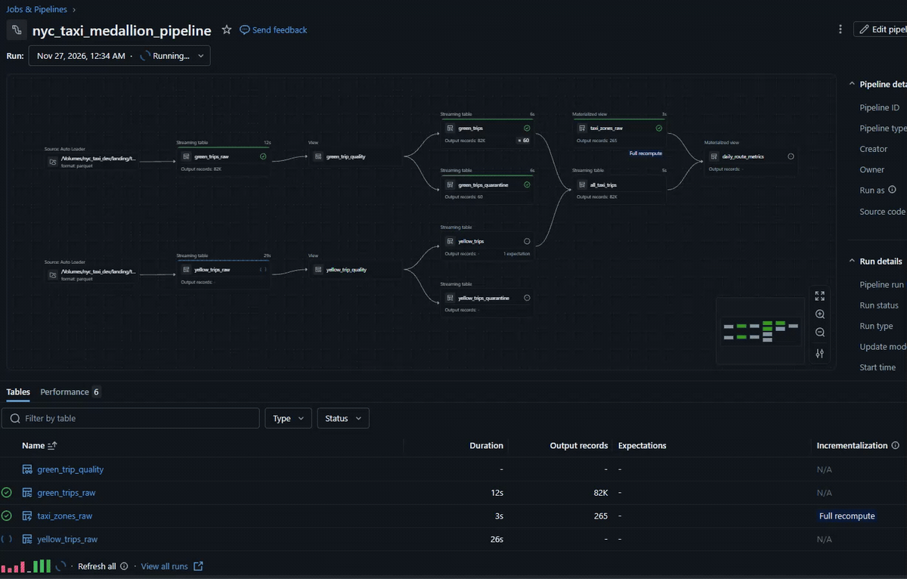

```text
Existing January data
        +
New February / March files
        │
        ▼
   Auto Loader
        │
        ▼
Bronze → Silver → Gold
```

---

# Dashboard

The Gold layer feeds the **NYC Taxi — Demand and Revenue** Databricks AI/BI dashboard. The dashboard uses each viewer’s credentials. In dev, analytics users need dashboard access, membership in the configured Unity Catalog analytics group for Gold reads. To query Gold directly in the SQL editor, they also need access to a SQL warehouse.

The dashboard covers:

* total trips;
* revenue;
* Yellow vs Green Taxi demand;
* monthly trends;
* route performance;
* borough and zone analysis;
* payment behavior;
* trip-distance metrics;
* trip-duration metrics.

The exported Lakeview dashboard definition is stored in:

```text
dashboards/NYC Taxi — Demand and Revenue.lvdash.json
```

---

# Infrastructure and CI

- **Azure Terraform** provisions the workspace, ADLS Gen2 containers (`trip-input`, `customer-input`, and `lakehouse-managed`), and the Databricks Access Connector with its managed identity. Azure Storage data-plane access uses Microsoft Entra authentication.
- **Unity Catalog Terraform** configures the storage credential, external locations, catalog, landing and restricted volumes, access grants, and the customer secret scope and ACLs. The Azure and Unity Catalog roots use separate state keys.
- **The Databricks bundle** builds the Python wheel and deploys the Bronze, Silver, and Gold schemas and grants, the triggered trip pipeline, the on-demand encryption job, and the dashboard.
- **GitHub Actions** runs Python and Spark tests, Terraform format and validation for both roots with the backend disabled, and a check of `databricks.yml` against the CLI bundle schema. Those checks run without the dev workspace.

See the [PowerShell deployment runbook](terraform/README.md) and the [customer encryption runbook](docs/customer-encryption.md).

---

# Project Structure

```text
NYC_Taxi_trips/
│
├── dashboards/
│   └── NYC Taxi — Demand and Revenue.lvdash.json
│
├── docs/
│   ├── dashboard/
│   │   ├── overview_top_1.png
│   │   ├── overview_bottom_1.png
│   │   ├── performance_top_1.png
│   │   ├── performance_bottom_1.png
│   │   ├── overview_top_2.png
│   │   ├── overview_bottom_2.png
│   │   ├── performance_top_2.png
│   │   └── performance_bottom_2.png
│   │
│   ├── customer-encryption.md
│   └── records/
│       ├── january.png
│       └── Incremental-10x.gif
│
├── notebooks/
│   ├── 01_bronze_layer.ipynb
│   ├── 02_silver_layer.ipynb
│   └── 03_gold_layer.ipynb
│
├── terraform/
│   ├── main.tf
│   ├── variables.tf
│   ├── versions.tf
│   └── unity-catalog/
│
├── tests/
├── customer_pool.py
├── databricks.yml
├── enrich_trip_data.py
├── encrypt_customers_job.py
├── trip_transforms.py
├── pyproject.toml
└── requirements.txt
```

## Main Components

### `01_bronze_layer.ipynb`

Implements:

* Auto Loader;
* streaming ingestion;
* Bronze tables;
* Taxi Zone reference-data ingestion.

### `02_silver_layer.ipynb`

Implements:

* data-quality expectations;
* invalid-record filtering;
* cleaned Silver tables.

### `03_gold_layer.ipynb`

Implements:

* Yellow and Green Taxi integration;
* append flows;
* Taxi Zone enrichment;
* Gold analytical metrics.

### Customer processing

- `enrich_trip_data.py` creates the versioned synthetic customer pool and assigns synthetic customer IDs to trip files. `customer_pool.py` generates deterministic synthetic customer rows.
- `encrypt_customers_job.py` is the deployed wheel entry point. It reads the staged pool, validates its metadata, encrypts the customer fields with Spark AES-256-GCM, and replaces the requested pool version in the restricted Delta table.

### `databricks.yml`

Defines the wheel build, triggered serverless trip pipeline, on-demand customer encryption job, medallion schemas and grants, and AI/BI dashboard.

### `terraform/`

Contains the Azure and Unity Catalog Terraform roots with separate remote state keys.

---

# Requirements

Before deployment, install:

* Azure CLI
* Terraform
* Python
* Databricks CLI

You also need:

* an Azure subscription;
* permissions to create Azure resources;
* access to Azure Databricks;
* NYC Taxi source datasets.

Install Python dependencies:

```bash
pip install -r requirements.txt
```

---

# Setup and Deployment

Follow the [PowerShell deployment runbook](terraform/README.md) for local validation, Azure and Unity Catalog provisioning, and the January and February–March dev updates.

# PII Preparation

## Prepare the synthetic customer pool

Use PowerShell from the repository root. The enrichment script writes a versioned customer pool separately from the enriched trip files.

```powershell
.\.venv\Scripts\python.exe enrich_trip_data.py --data-dir data --pool-version v1
```

## Stage and encrypt the customer pool

Upload `customers.parquet` and `pool.json` from the same `data/enriched/customer_pools/v1/` directory to `/Volumes/<catalog>/restricted/customers/incoming/v1/`. Follow the [customer encryption runbook](docs/customer-encryption.md) to configure the job identity and seed the Databricks Secrets key before running the job.

The wheel task reads the requested pool version and key ID, then writes `<catalog>.restricted.customers_encrypted`. In dev, a query for pool `v1` and key `k1` returned **10,000 rows and 10,000 distinct customer IDs**. An authorized sample decryption check returned `true` without displaying plaintext.

Publish trip Parquet separately to the governed trip volume and keep those file paths immutable. Customer IDs are unique within a pool version. Use the enrichment batch manifest to resolve the pool version for trip inputs.

---

# Verify the Dashboard

### January

#### Overview

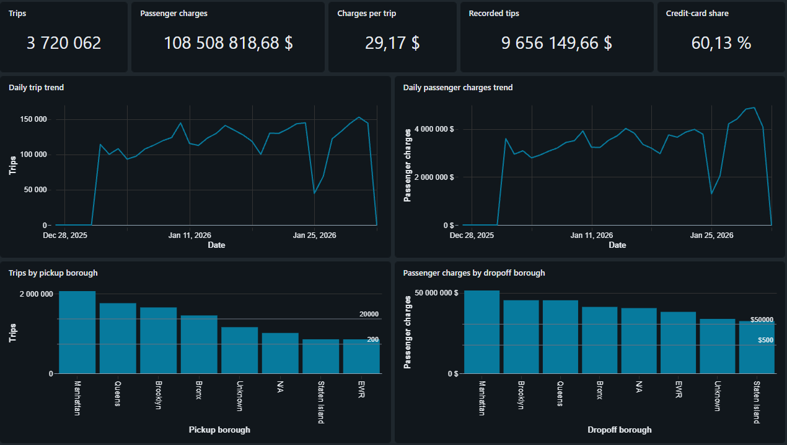
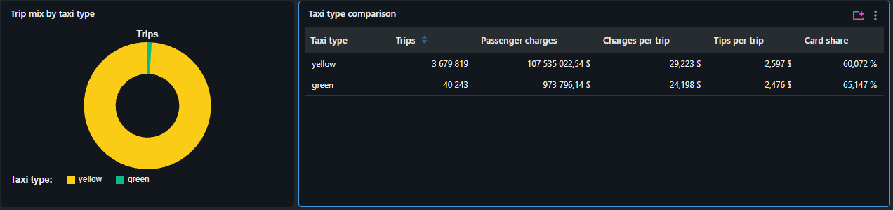

#### Performance

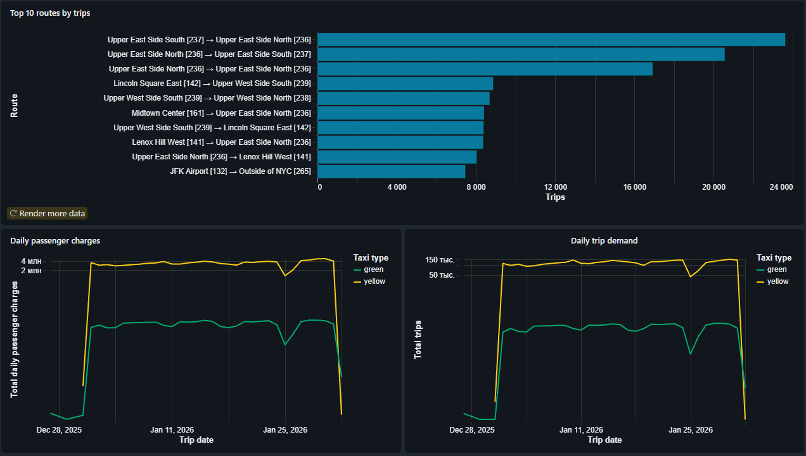
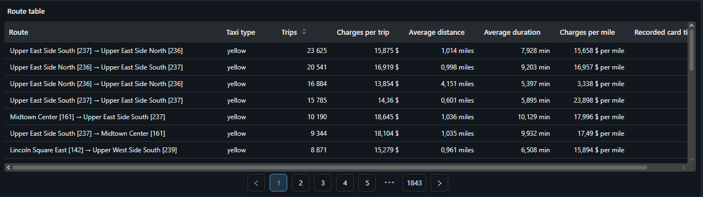
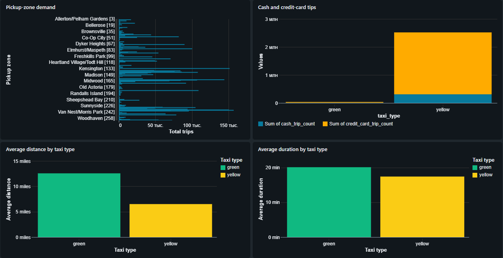

---

### January–March

After February and March are incrementally ingested, the same dashboard reflects all three months of data.

#### Overview

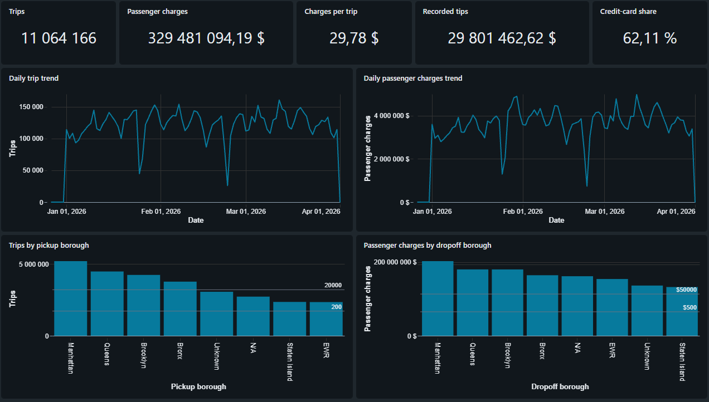
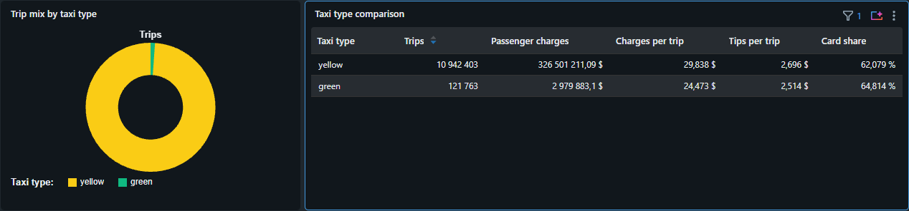

#### Performance

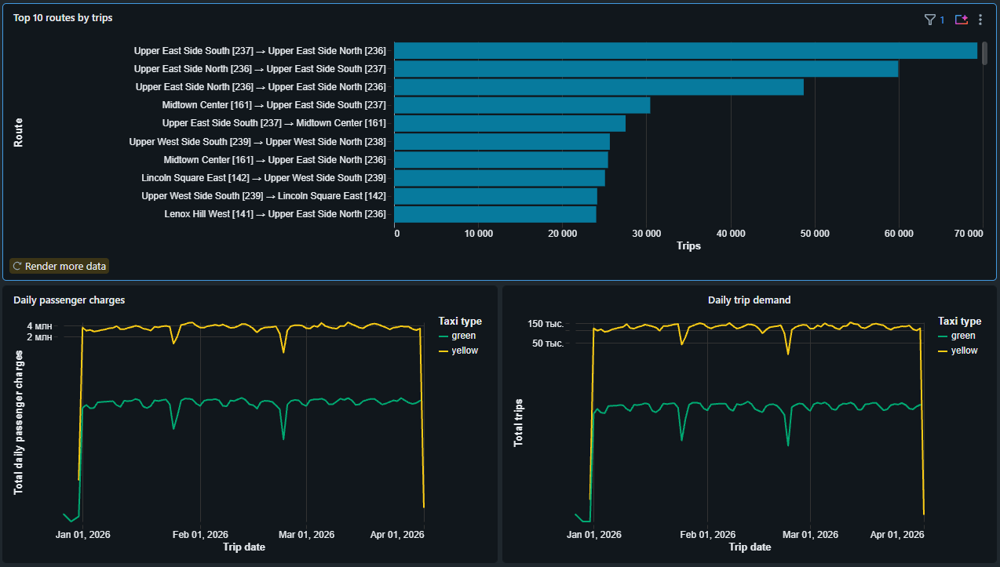
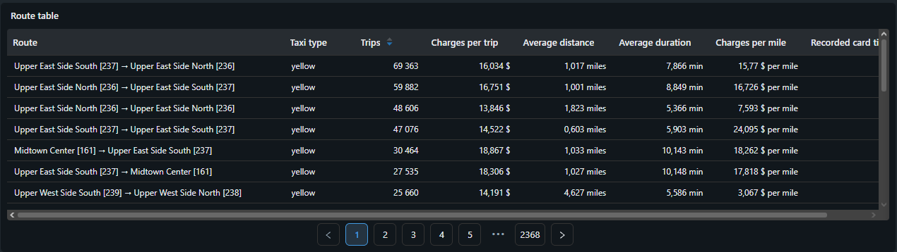
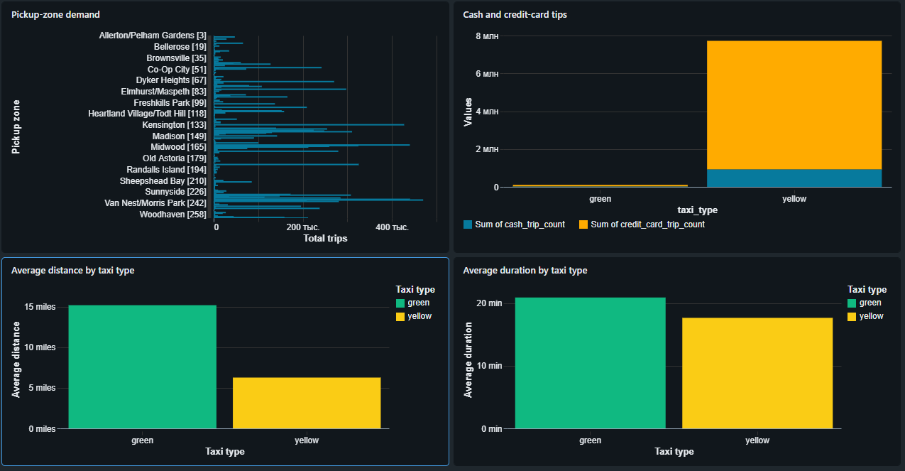

---

# Data Security

The restricted table stores the customer ID, pool version, pool seed, key ID, and binary AES-256-GCM ciphertext for the first name, last name, and email. The dedicated job identity reads the key from a Databricks secret scope. The scope grants key access to the job identity and customer administrators. Keep key values out of Git, Terraform state, deployment parameters, and logs.

The trip pipeline and dashboard use trip data and zone references. Analysts read the Gold schema with their own credentials. Customer-table access and decryption are governed separately through Unity Catalog grants and secret-scope ACLs.

---

# Key Engineering Concepts Demonstrated

* Azure cloud infrastructure
* Infrastructure as Code with Terraform
* Azure Data Lake Storage Gen2
* Azure Databricks
* Azure Access Connector
* Managed Identity
* Unity Catalog
* Storage Credentials
* External Locations
* Medallion Architecture
* Lakeflow Declarative Pipelines
* Databricks serverless compute
* Apache Spark
* PySpark
* Spark Structured Streaming
* Databricks Auto Loader
* incremental ingestion
* Delta Lake
* streaming tables
* materialized views
* Multiflow pattern with Lakeflow append flows
* data-quality expectations
* reference-data enrichment
* PII encryption
* Python wheel packaging
* Databricks Asset Bundles
* Terraform outputs and environment configuration
* analytical aggregation
* Databricks AI/BI dashboards
* Automated CI checks with GitHub Actions
